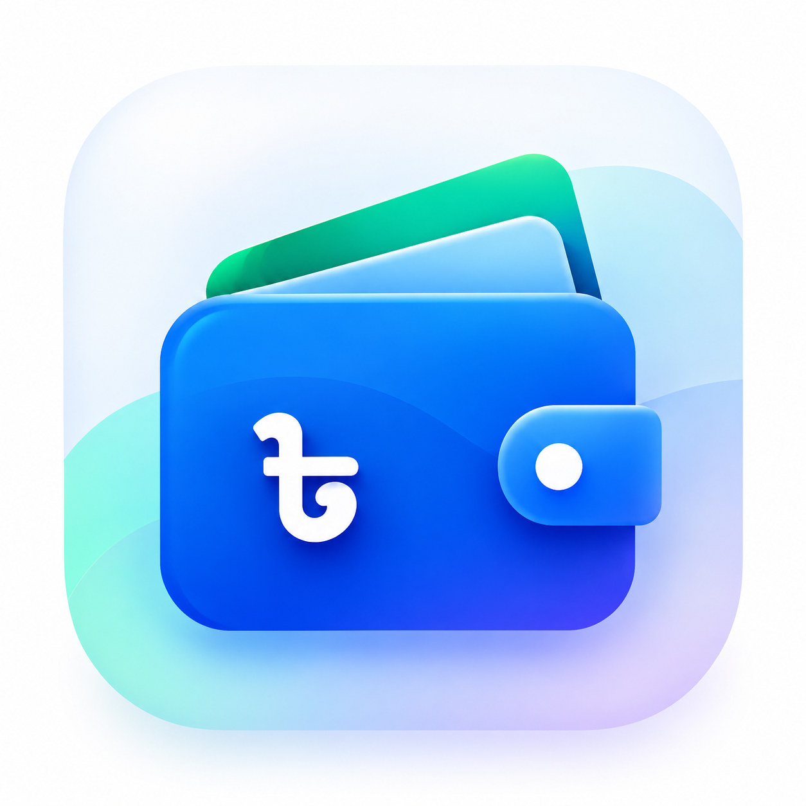

<div align="center">
  
  <h1>Hishab Pati (হিসাব পাতি)</h1>
  <p><strong>Your Money, Your Control.</strong></p>
  <p>A modern, offline-first personal finance &amp; expense tracker built with React, TypeScript, Tailwind CSS v4, and Firebase—tailored for Bangladesh and beyond.</p>
</div>

---

## ✨ Overview

**Hishab Pati** is a privacy-focused, offline-first personal finance web application designed to organize daily transactions, monitor spending, and manage accounts, budgets, savings goals, and debts in one place. Built with **React**, **TypeScript**, **Tailwind CSS v4**, and **Vite**, it pairs a calm frosted-glass interface with localized banking directories—including **61 local banks** and **13 Mobile Financial Services (MFS)** providers—while keeping your financial records stored privately in your browser with optional Firebase Cloud Sync.

---

## 🌟 Key Highlights

* 🇧🇩 **Bangladesh Financial Ecosystem:** Pre-loaded directory of **61 Local Banks** and **13 MFS Providers** (*bKash, Nagad, Rocket, Upay, MYCash, Islami Bank mCash, TAP,* and more) with authentic brand badges and interactive card previews.
* 🌐 **Full Bilingual Experience (English & বাংলা):** Switch seamlessly between **English** and **বাংলা (Bangla)** with localized South Asian comma grouping and Bangla numerals (`০-৯`).
* 🔒 **Offline-First & Optional Cloud Sync:** Works 100% offline in Guest Mode (`localStorage`) with zero mandatory sign-up, plus optional **Google Sign-In & Firebase Cloud Firestore** real-time sync and cloud backup.
* 🎙️ **Smart Transaction Entry:** Log transactions with the **built-in Calculator Keypad**, **Voice/Smart Entry parser** (English, Bangla & Banglish), and **Receipt Review & Total Parser**.
* 🧰 **All-in-One Financial Toolkit:** Built-in **Currency Converter** (live & custom remittance rates), **Net Worth tracker**, **Monthly Recap**, **Spending Comparison**, **Income Tracker**, and **Financial Calendar**.

---

## 🚀 Features

### 💳 Multi-Wallet & Card Management
* Manage **Bank Accounts**, **Credit Cards** (credit limit utilization & due dates), **Cash**, **MFS Wallets**, and **Other** accounts.
* Interactive virtual card artwork with EMV chip graphics, card network badges (*Visa, Mastercard, American Express, UnionPay*), custom colors, archiving, custom ordering, and balance reconciliation.

### ⚡ Fast Transaction Logging & Searchable Ledger
* Log **Expense**, **Income**, **Transfer**, **Lent**, **Borrowed**, and **Credit Card Payment** entries.
* Full **Activity** ledger with search, type tabs, multi-criteria filtering (accounts, categories, date range), sorting, and filtered summary reports.

### 🎯 Planning, Budgets, Goals & Debts
* **Budget Dashboard:** Overall and category-level monthly budgets with daily safe spend and an interactive **2-ring SVG Sunburst Chart**.
* **Loans & Debt Ledger (Dena-Paona):** Track lent and borrowed balances, partial repayments, additional lending/borrowing, interest additions, and settlements.
* **Savings Goals:** Track targeted savings goals with deadline and contribution logging.

### 📊 Insights & Backups
* Interactive SVG trend line chart, donut breakdown with subcategory drill-down, and CSV / Clipboard / Printable report export.
* Full **JSON & CSV backup export/import**, legacy backup migration engine, sample dataset loader, and Firebase Cloud Backup snapshots.
* Customizable Home dashboard widgets, 13 theme color presets, 7 background textures, Light/Dark/Auto mode, and optional App Passcode Lock.

---

## 🛠️ Tech Stack

* **Frontend:** React 19, TypeScript, Tailwind CSS v4, Vite, Lucide Icons
* **Local Persistence:** Browser `localStorage` with automatic balance reconciliation
* **Cloud & Authentication:** Firebase Authentication (Google Sign-In) & Cloud Firestore

---

## 🏃 Local Development

```bash
npm install
npm run dev
```

Build & lint:

```bash
npm run build
npm run lint
```

---

## 👨‍💻 Developer Credit

Original concept & application by **Khan Istiak Shahabuddin** — Made with ❤️ in Bangladesh.
